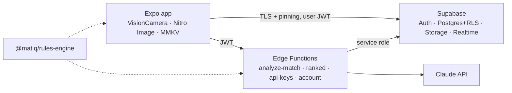

# MatIQ: AI Martial Arts Analyzer & Social Hub

**Current release: Pre-Beta V1.2.9** ([changelog](CHANGELOG.md))

MatIQ records or imports sparring footage, detects what happened with a
vision model, and scores it with a deterministic rules engine for
**Brazilian Jiu-Jitsu**, **wrestling** (folkstyle and freestyle) and **MMA**.
Every match is exactly two fighters, Fighter 1 vs Fighter 2. Athletes get a
post-match dashboard (timeline, phases, highlights, stats, coaching notes),
can share scorecards with friends or the community, and can climb a ranked
Elo ladder with opponent-confirmed results, tiers from Bronze / White Belt to
Grandmaster / Black Belt, and titles earned from their stats. Privacy is
enforced in the database.

> Your data, profile and videos are stored to run the app and power your
> analytics. They are never sold or shared with data brokers.

## Highlights

- **Dual input**: hardware-encoded 1080p live recording at 60 FPS (30 FPS
  minimum, chosen per device), or MP4/MOV import from the gallery. AI frames
  are sampled on the camera's own thread at about 1 FPS, motion-pruned and
  uploaded progressively through a bounded ring-buffer queue.
- **AI analysis**: Claude (structured outputs) detects discipline-specific
  events; the shared rules engine turns them into points, advantages,
  projected round scores, phases and highlights.
- **Live analysis**: while recording, frames are analysed in batches of 20
  and a provisional score appears over the camera after the first batch
  (typically under a minute); at the end only the frames no batch covered
  are analysed. One quota unit per match.
- **Post-match dashboard**: video with a tap-to-seek phase timeline,
  highlight clips that play and stop on their own, head-to-head stats, a
  technique breakdown (points by technique, BJJ position time and
  submissions, wrestling shots, MMA strikes by target and position), an
  athlete filter, coaching notes and a scoring log. Failed analyses can be
  retried in one tap.
- **Security first**: Row Level Security on every table, private-by-default
  accounts, encrypted on-device storage (MMKV AES-256 with a Keychain/Keystore
  key), TLS public-key pinning, AES-256-GCM vault for bring-your-own API keys,
  rate limits, audited owner actions, and optional TOTP two-factor
  authentication enforced in the database, Storage, Realtime and Edge
  Functions (not just the app).
- **Ranked ladder**: challenge a training partner, record the match, and both
  fighters confirm the analysed result before Elo changes (finishes count
  more, placement matches move faster). Five tiers with three divisions each
  (Bronze / White Belt up to Grandmaster / Black Belt), matchmaking by
  rating, global and friends leaderboards, and 16 dynamic titles such as
  *Submission Wizard*, *Takedown Machine* and *Iron Chin*. Anti-abuse rules:
  a win you record needs your opponent's confirmation, at most 3 ranked
  matches per pair per week, disputes go to the Owner Panel.
- **Usage limits + Owner Panel**: atomic monthly quotas, an `is_unlimited`
  switch, per-user limits, suspension, usage overview, ranked dispute
  resolution and audit log.
- **Social**: profile pictures (re-encoded on device, metadata stripped),
  friend requests, blocks, likes, and a feed of scorecards and playable video
  highlights that runs under the caller's RLS so it cannot leak private
  content.
- **Data rights**: in-app Privacy Policy and Terms (versioned acceptance
  records), data export and account deletion.

## Architecture



Details: [docs/ARCHITECTURE.md](docs/ARCHITECTURE.md). Security model and
deployment: [docs/SECURITY_AND_DEPLOYMENT.md](docs/SECURITY_AND_DEPLOYMENT.md).

## Repository layout

```
.
├── apps/mobile/                     Expo (SDK 58) React Native app
│   ├── app.config.ts                permissions, R8/cleartext/backup hardening
│   ├── babel/strip-console.js       removes console.* from release builds
│   ├── scripts/                     browser UI preview server + Playwright walkthrough
│   └── src/
│       ├── app/                     Expo Router screens
│       │   ├── (auth)/              sign in / sign up (+ consent)
│       │   ├── (app)/(tabs)/        feed · analyze · ranked · matches · profile
│       │   ├── (app)/match/[id]     post-match dashboard
│       │   ├── (app)/ranked/        opponents (matchmaking), ladder, titles, ranked match
│       │   ├── (app)/admin          owner panel
│       │   ├── (app)/settings/      privacy, API keys, export, delete account
│       │   └── legal/[doc]          Privacy Policy / Terms of Service
│       ├── config/env.ts            validated public config
│       ├── lib/                     supabase client, encrypted storage, pinning, validation
│       ├── preview/                 browser UI preview only: sample data, fake backend, native stubs
│       └── features/
│           ├── capture/             dual-input handler, live recorder, uploader, frame pipeline
│           ├── analysis/            dashboard, technique breakdown, realtime match status
│           ├── ranked/              ranked state machine, ladder data, tier badges, ranked recording
│           ├── social/              feed, posts, friends, privacy toggle
│           ├── admin/               owner panel
│           ├── api-keys/            BYOK client
│           └── legal/               policy text + consent records
├── packages/rules-engine/           BJJ / wrestling / MMA scoring + ranked Elo, tiers, titles (pure TS, tested)
├── supabase/
│   ├── config.toml                  hardened local config
│   ├── migrations/                  schema, RLS, quotas, social, owner panel, storage, live analysis, 2FA, ranked
│   ├── functions/                   Deno Edge Functions + shared middleware
│   └── tests/                       pgTAP security tests (+ Docker-free harness)
├── scripts/                         rules-engine sync, local DB tests, KEK rotation
├── docs/                            architecture and security/deployment guides
├── CHANGELOG.md                     release notes
└── .github/                         CI (tests, type checks, UI walkthrough, secret scan) and release workflow
```

## Getting started

Prerequisites: Node 22+, npm 10+, [Supabase CLI](https://supabase.com/docs/guides/cli)
with Docker, Deno 2 (for function checks), and Xcode or Android Studio (or
EAS Build). VisionCamera, Nitro and MMKV are native modules, so the app runs
in a development build, not Expo Go.

```bash
npm install

# Backend
supabase start
supabase db reset                       # applies migrations
cp supabase/functions/.env.example supabase/functions/.env   # add ANTHROPIC_API_KEY, MATIQ_KEK_V1
npm run functions:serve

# App
cp apps/mobile/.env.example apps/mobile/.env   # local Supabase URL + anon key
cd apps/mobile
npx expo prebuild --clean
npx expo run:ios      # or: npx expo run:android
```

Make your account the owner (SQL editor, once):

```sql
update public.user_entitlements set role = 'owner', is_unlimited = true
where user_id = (select id from auth.users where email = 'you@example.com');
```

## Testing

| Command | What it checks |
|---|---|
| `npm test --workspace @matiq/rules-engine` | 47 tests: scoring (IBJJF, IBJJF + reversals, folkstyle, freestyle, MMA rounds) and ranking (Elo, tiers, career stats, titles, settlement) |
| `npm test --workspace @matiq/mobile` | 38 tests: capture plan selection (60/30 FPS), frame sampling, pruning, ring buffer, technique breakdown, highlight-link clamping, TOTP input, ranked match states, fighter-name labels |
| `npm run typecheck` | TypeScript across the workspaces |
| `supabase test db` | 133 pgTAP checks: RLS privacy, blocks, friend graph, privilege escalation, owner panel + MFA, audit log, quotas, storage, live-analysis batch claiming, two-factor enforcement, ranked lifecycle (rulesets per discipline, confirmation rules, versioned settlement, ladder privacy, disputes, anti-farming) |
| `./scripts/test-db-local.sh` | the same tests against plain Postgres, no Docker |
| `npm run functions:check` / `npm run functions:test` | Deno type check; 15 tests for vault crypto, live-batch frame selection, the two-factor claim check and ranked settlement payloads |
| `npm run secrets:scan` | gitleaks secret scan |
| `npm run preview:web && npm run preview:walkthrough` (in `apps/mobile`) | builds the browser UI preview with sample data and clicks through every screen with Playwright (36 steps, fails on any runtime error, saves screenshots) |

## See the UI without a phone

`apps/mobile` can be built as a browser **UI preview** with sample data
(an in-memory backend, the real rules engine, a simulated camera). It is
for design review and QA, not a web version of MatIQ. See
[apps/mobile/src/preview/README.md](apps/mobile/src/preview/README.md).

```bash
cd apps/mobile
npm run preview:web && npm run preview:serve   # http://127.0.0.1:8081
# sign in with demo@matiq.app / matiq-preview
```

## Releases

Pushing a version tag runs [`.github/workflows/release.yml`](.github/workflows/release.yml):
it builds an installable Android APK (debug-signed, for testers),
re-runs the UI walkthrough and publishes a GitHub release with the
changelog section, the APK, its SHA-256 checksum and the screenshots.
Tags with a suffix are published as pre-releases: `v1.2.9-pre-beta`
becomes **Pre-Beta V1.2.9**.

```bash
git tag -a v1.2.9-pre-beta -m "Pre-Beta V1.2.9" && git push origin v1.2.9-pre-beta
```

Before tagging, set the public client config as repository **variables**
(Settings → Secrets and variables → Actions → Variables):
`EXPO_PUBLIC_SUPABASE_URL`, `EXPO_PUBLIC_SUPABASE_ANON_KEY`, and optionally
`EXPO_PUBLIC_TLS_PINS`, `EXPO_PUBLIC_LEGAL_ENTITY`, `EXPO_PUBLIC_SUPPORT_EMAIL`.
Store builds (App Store, Play Store) go through EAS with the profiles in
[`apps/mobile/eas.json`](apps/mobile/eas.json).

## Where each part lives

| Deliverable | Files |
|---|---|
| Database schema with RLS, Elo and rank tables | [`supabase/migrations/`](supabase/migrations) (ranked: [`20261028000100_ranked.sql`](supabase/migrations/20261028000100_ranked.sql)) |
| Secure API key vault and proxy | [`supabase/functions/api-keys`](supabase/functions/api-keys), [`_shared/crypto.ts`](supabase/functions/_shared/crypto.ts), [`analyze-match`](supabase/functions/analyze-match) (the proxy: keys never reach the app) |
| Two-fighter scoring engine | [`packages/rules-engine/src/disciplines`](packages/rules-engine/src/disciplines) (`bjj.ts`, `wrestling.ts`, `mma.ts`) |
| Ranked Elo and dynamic title calculator | [`packages/rules-engine/src/ranking`](packages/rules-engine/src/ranking), applied by [`supabase/functions/ranked`](supabase/functions/ranked) |
| Owner Panel | [`apps/mobile/src/features/admin/OwnerPanel.tsx`](apps/mobile/src/features/admin/OwnerPanel.tsx), [`20261023000600_owner_panel.sql`](supabase/migrations/20261023000600_owner_panel.sql) |
| Dual-input camera and upload | [`apps/mobile/src/features/capture`](apps/mobile/src/features/capture) (`DualInputHandler.tsx`, `LiveRecorder.tsx`, `VideoUploader.tsx`) |
| Social feed with privacy filters | [`apps/mobile/src/features/social`](apps/mobile/src/features/social), [`20261023000500_social.sql`](supabase/migrations/20261023000500_social.sql) (`get_feed` runs under the caller's RLS) |

## Configuration

- [`.env.example`](.env.example): full variable reference.
- [`apps/mobile/.env.example`](apps/mobile/.env.example): public app values only.
- [`supabase/functions/.env.example`](supabase/functions/.env.example): server secrets.

## Legal

The in-app [Privacy Policy and Terms](apps/mobile/src/features/legal/documents.ts)
are templates written for MatIQ's actual data flows. Have them reviewed by
counsel before release. Scorecards are training aids, not official refereeing
or judging decisions, and rule values should be checked against the current
rulebook of the competition you train for.

## License

No license has been chosen yet; all rights reserved by the repository owner
until one is added.
