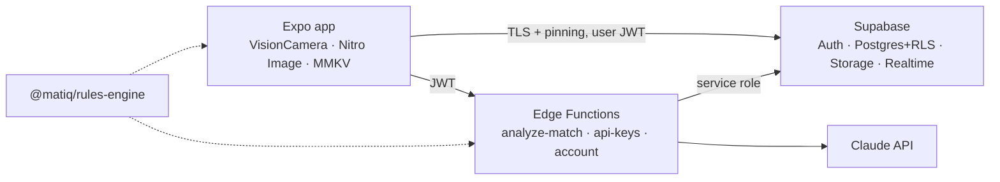

# MatIQ: AI Martial Arts Analyzer & Social Hub

MatIQ records or imports sparring footage, detects what happened with a
vision model, and scores it with a deterministic rules engine for
**Brazilian Jiu-Jitsu**, **wrestling** (folkstyle and freestyle) and **MMA**.
Athletes get a post-match dashboard (timeline, phases, highlights, stats,
coaching notes) and can share scorecards with friends or the community,
with privacy enforced in the database.

> Your data, profile and videos are stored to run the app and power your
> analytics. They are never sold or shared with data brokers.

## Highlights

- **Dual input**: hardware-encoded 1080p/30 FPS live recording, or MP4/MOV
  import from the gallery. Both produce 1-2 FPS, motion-pruned frames that
  upload progressively through a bounded ring-buffer queue.
- **AI analysis**: Claude (structured outputs) detects discipline-specific
  events; the shared rules engine turns them into points, advantages,
  projected round scores, phases and highlights.
- **Security first**: Row Level Security on every table, private-by-default
  accounts, encrypted on-device storage (MMKV AES-256 with a Keychain/Keystore
  key), TLS public-key pinning, AES-256-GCM vault for bring-your-own API keys,
  rate limits, audited owner actions.
- **Usage limits + Owner Panel**: atomic monthly quotas, an `is_unlimited`
  switch, per-user limits, suspension, usage overview and audit log.
- **Social**: friend requests, blocks, likes, and a feed that runs under the
  caller's RLS so it cannot leak private content.
- **Data rights**: in-app Privacy Policy and Terms (versioned acceptance
  records), data export and account deletion.

## Architecture



Details: [docs/ARCHITECTURE.md](docs/ARCHITECTURE.md). Security model and
deployment: [docs/SECURITY_AND_DEPLOYMENT.md](docs/SECURITY_AND_DEPLOYMENT.md).

## Repository layout

```
.
├── apps/mobile/                     Expo (SDK 58) React Native app
│   ├── app.config.ts                permissions, R8/cleartext/backup hardening
│   ├── babel/strip-console.js       removes console.* from release builds
│   └── src/
│       ├── app/                     Expo Router screens
│       │   ├── (auth)/              sign in / sign up (+ consent)
│       │   ├── (app)/(tabs)/        feed · analyze · matches · profile
│       │   ├── (app)/match/[id]     post-match dashboard
│       │   ├── (app)/admin          owner panel
│       │   ├── (app)/settings/      privacy, API keys, export, delete account
│       │   └── legal/[doc]          Privacy Policy / Terms of Service
│       ├── config/env.ts            validated public config
│       ├── lib/                     supabase client, encrypted storage, pinning, validation
│       └── features/
│           ├── capture/             dual-input handler, live recorder, uploader, frame pipeline
│           ├── analysis/            dashboard, realtime match status
│           ├── social/              feed, posts, friends, privacy toggle
│           ├── admin/               owner panel
│           ├── api-keys/            BYOK client
│           └── legal/               policy text + consent records
├── packages/rules-engine/           BJJ / wrestling / MMA scoring (pure TS, tested)
├── supabase/
│   ├── config.toml                  hardened local config
│   ├── migrations/                  schema, RLS, quotas, social, owner panel, storage
│   ├── functions/                   Deno Edge Functions + shared middleware
│   └── tests/                       pgTAP security tests (+ Docker-free harness)
├── scripts/                         rules-engine sync, local DB tests, KEK rotation
├── docs/                            architecture and security/deployment guides
└── .github/                         CI (tests, type checks, bundle check, secret scan)
```

## Getting started

Prerequisites: Node 22+, npm 10+, [Supabase CLI](https://supabase.com/docs/guides/cli)
with Docker, Deno 2 (for function checks), and Xcode or Android Studio (or
EAS Build). VisionCamera, Nitro and MMKV are native modules, so the app runs
in a development build, not Expo Go.

```bash
npm install

# Backend
supabase start
supabase db reset                       # applies migrations
cp supabase/functions/.env.example supabase/functions/.env   # add ANTHROPIC_API_KEY, MATIQ_KEK_V1
npm run functions:serve

# App
cp apps/mobile/.env.example apps/mobile/.env   # local Supabase URL + anon key
cd apps/mobile
npx expo prebuild --clean
npx expo run:ios      # or: npx expo run:android
```

Make your account the owner (SQL editor, once):

```sql
update public.user_entitlements set role = 'owner', is_unlimited = true
where user_id = (select id from auth.users where email = 'you@example.com');
```

## Testing

| Command | What it checks |
|---|---|
| `npm test --workspace @matiq/rules-engine` | 27 scoring tests (IBJJF, folkstyle, freestyle, MMA rounds) |
| `npm test --workspace @matiq/mobile` | frame sampling, pruning and ring buffer |
| `npm run typecheck` | TypeScript across the workspaces |
| `supabase test db` | 58 pgTAP checks: RLS privacy, blocks, friend graph, privilege escalation, owner panel + MFA, audit log, quotas, storage |
| `./scripts/test-db-local.sh` | the same tests against plain Postgres, no Docker |
| `npm run functions:check` / `npm run functions:test` | Deno type check, vault crypto tests |
| `npm run secrets:scan` | gitleaks secret scan |

## Configuration

- [`.env.example`](.env.example): full variable reference.
- [`apps/mobile/.env.example`](apps/mobile/.env.example): public app values only.
- [`supabase/functions/.env.example`](supabase/functions/.env.example): server secrets.

## Legal

The in-app [Privacy Policy and Terms](apps/mobile/src/features/legal/documents.ts)
are templates written for MatIQ's actual data flows. Have them reviewed by
counsel before release. Scorecards are training aids, not official refereeing
or judging decisions, and rule values should be checked against the current
rulebook of the competition you train for.

## License

No license has been chosen yet; all rights reserved by the repository owner
until one is added.
