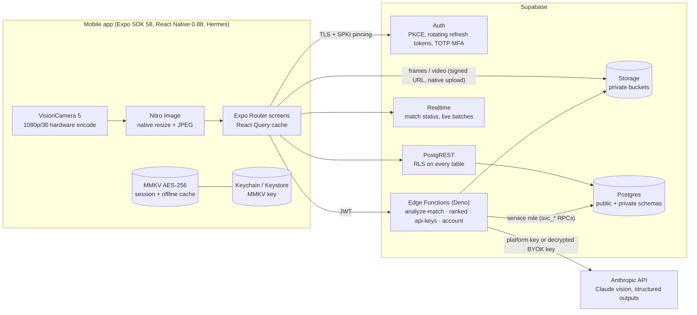
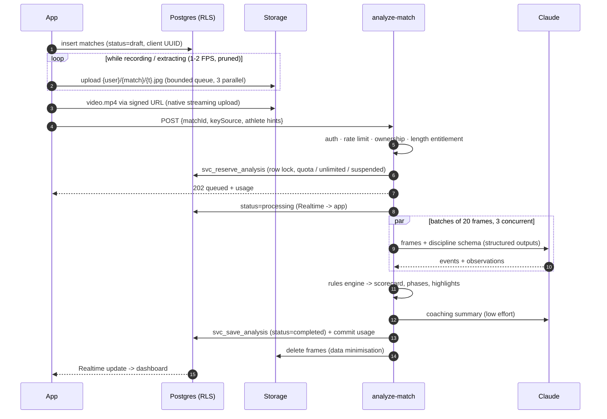
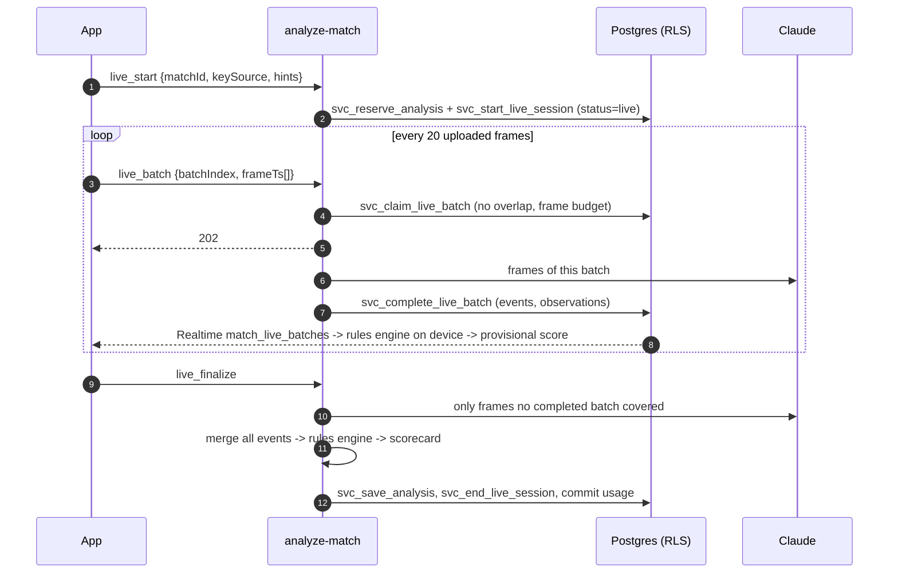
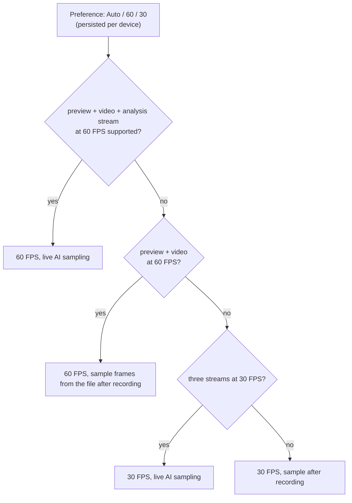
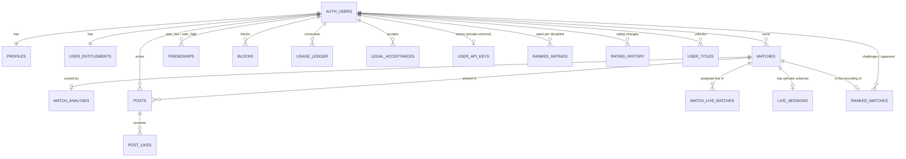
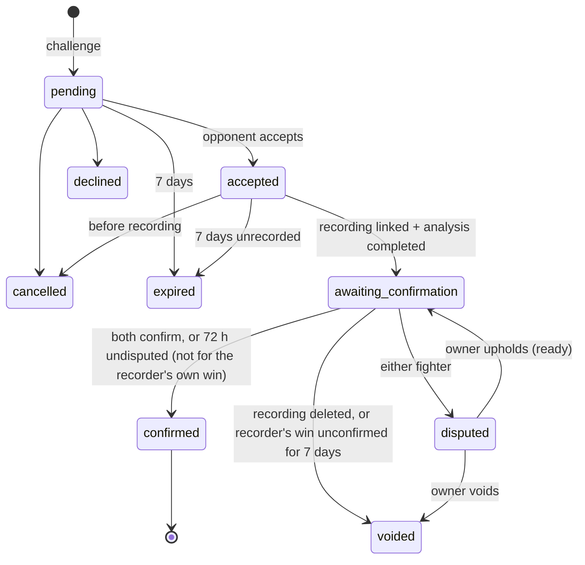

# MatIQ architecture

## System overview

| Layer | Responsibility | Key files |
|---|---|---|
| Mobile app | Capture, local encryption, UI, optimistic caching | `apps/mobile/src` |
| Rules engine | Deterministic scoring shared by app and server | `packages/rules-engine` |
| Postgres | Data, RLS privacy rules, quotas, rate limits, audit log | `supabase/migrations` |
| Edge Functions | AI orchestration, BYOK vault, data export/deletion | `supabase/functions` |
| Anthropic API | Event detection from frames, coaching notes | `supabase/functions/_shared/ai` |

## Analysis pipeline

Failure at any step marks the match `failed` with an error code and refunds
the reservation; reservations abandoned by a crashed worker are refunded
automatically (after 30 minutes, or twice the plan's maximum video length
plus 15 minutes for long live sessions). The owner can retry a failed
analysis from the match screen; frames are only deleted after a success.

### Live analysis (provisional score while recording)

When the capture plan samples frames during recording, the same
`analyze-match` function runs incrementally:

- **One quota unit per match**, reserved at `live_start`; cancel refunds it.
- **Each frame is analysed at most once.** A batch claim is rejected if its
  frames overlap a pending or completed batch, if it would exceed the
  per-match frame budget, or if the client names frames that are not in
  storage (the server lists the bucket; clients cannot inject paths).
- **Provisional scoring runs on the device** with the same rules engine
  package as the server, so the live number and the final scorecard follow
  identical rules; the final scorecard additionally covers leftover frames
  and coaching notes.
- A match abandoned mid-recording stays `live`; deleting it releases the
  reservation, and the stale-reservation sweep refunds it otherwise.

### Rulesets

Every scorecard is Fighter 1 (athlete A) vs Fighter 2 (athlete B).

| Discipline | Variants | Scoring |
|---|---|---|
| BJJ | `ibjjf`, `ibjjf_reversals`, `submission_only` | Takedown, sweep, knee on belly 2 · guard pass 3 · mount, back control 4 (3 s stabilisation), advantages, penalty progression, submissions. `ibjjf_reversals` adds 2 points for a stabilised reversal from a non-guard bottom position (IBJJF itself only scores reversals from guard, as sweeps). |
| Wrestling | `folkstyle`, `freestyle` | Folkstyle: takedown 3, escape 1, reversal 2, near fall 2/3/4 by hold time, riding time 1 (≥ 1:00 net), falls, technical fall at 15. Freestyle: takedown 2 (4 to danger), grand amplitude 4/5, exposure 2, step-out 1, reversal 1, passivity 1, cautions, technical superiority at 10. |
| MMA | `unified` | Strikes landed/attempted by target and position, knockdowns, takedowns, control time, submission attempts, finishes; projected 10-point-must round scores. |

### Why the AI only detects events

Vision models are good at recognising *what happened* and poor at applying
rulebooks consistently. MatIQ therefore splits the job:

1. Claude receives timestamped frames and a schema generated from the rules
   engine's vocabulary (`_shared/ai/schemas.ts`), so it can only emit known
   event types.
2. The rules engine (`packages/rules-engine`) validates every event again,
   drops low-confidence ones, and computes points, advantages, round scores,
   phases and highlights deterministically.
3. Raw events are stored next to the scorecard, so matches can be re-scored
   when rules change without paying for another AI call.

## Post-match dashboard

`MatchDashboard.tsx` renders, from the saved scorecard only (no extra AI
calls): the video, a phase timeline (tap anywhere to seek; markers play
their highlight clip and pause at its end), highlights, projected rounds,
head-to-head stats, a technique breakdown (`technique-breakdown.ts`: points
by technique from the scoring log, BJJ position time and submission
attempts by technique, wrestling shots and mat work, MMA strikes by target
and position, grappling), coaching notes and the scoring log. An athlete
filter narrows highlights and the scoring log and dims the other athlete in
the breakdown. Feed posts that feature a highlight link to
`/match/{id}?t=…&end=…`; the range is clamped to the recording and capped at
60 s (`resolveClip`), and access to the video is decided by storage RLS.

## Capture and performance (30-60 FPS)

Recording targets **60 FPS** and never drops below **30 FPS**. The frame rate
and output combination are chosen per device before the session starts:

`useCapturePlan` asks VisionCamera to negotiate each candidate
(`resolveConstraints`) and verifies it (`isSessionConfigSupported`), so a
recording never starts in a configuration the hardware cannot sustain.

| Concern | Approach |
|---|---|
| Preview / recording at 60 FPS | Fully native (VisionCamera 5, Nitro/JSI): buffers go straight to the preview layer and the hardware encoder. JS never touches full-rate frames. |
| Session constraints | Priority order: `fps` > recording resolution > stabilization off > 8-bit SDR > binned sensor readout. Each later constraint removes a common reason devices fall back to 30 FPS (stabilization crop/latency, HDR bandwidth, full-sensor readout). Low-light boost is disabled because it lowers the frame rate to lengthen exposure. |
| AI sampling | A worklet on the frame output's own thread (`frame-thread-sampler.ts`). Per frame it only counts (live FPS measurement) and disposes the buffer; about once per second it converts, downscales to 640 px, prunes static frames (16-px luminance signature) and encodes a JPEG asynchronously. Only a file path reaches JS. |
| Buffer pool | Every frame is disposed exactly once in a `finally`; an undisposed frame would stall the whole camera pipeline, preview included. |
| Analysis stream cost | Preview-sized buffers (`enablePreviewSizedOutputBuffers`), `dropFramesWhileBusy`, deferred start so preview comes up first. |
| React re-renders | `<Camera>` props (outputs, constraints, callbacks) are memoized on the plan. Recording clock and stats flow through an external store that only the HUD subscribes to, so the camera subtree does not re-render while recording. |
| Backpressure | The JS side doubles the sampling interval when the upload queue is more than 75% full; the queue itself is a 120-frame ring buffer. |
| Thermal pressure | An iOS system-pressure interruption stops and saves the take, and the HUD suggests 30 FPS. |
| Bit rate | 14 Mbps for Auto/60, 9 Mbps for 30 FPS (1080p; platform default codec, which is HEVC on most iPhones). |
| Large videos | Streamed from disk by the OS uploader (`expo-file-system` `File.upload`, background session on iOS) to a short-lived signed URL. |
| Gallery uploads / record-only plans | `expo-video-thumbnails` decodes one frame at a time from the file, then the same pruning and JPEG path; sampling and the video upload run in parallel. |

The HUD shows the negotiated FPS before the first frame arrives and the
measured, delivered FPS once the analysis stream is running.

## Data model

`private` schema (not exposed through the API): `user_api_keys`,
`rate_limits`, `admin_audit_log`, `app_config`, `live_sessions`, and every
helper used by RLS.

## Privacy model

Effective visibility of a **post** (and of the match, analysis and video it
shares), enforced by `private.can_view_author_content`:

| Viewer | Author account | Post | Visible? |
|---|---|---|---|
| Author | any | any | yes |
| Blocked (either direction) | any | any | **no** |
| Accepted friend | any | any | yes |
| Other signed-in user | Public | not friends-only | yes |
| Other signed-in user | Public | friends-only | no |
| Other signed-in user | Private (default) | any | no |
| Anonymous | any | any | no (anon has no table access) |

Matches, analyses and videos that are **not** shared in a post are visible
only to their owner. Profile cards (username, display name, avatar, bio) are
visible to signed-in users who are not blocked, so friend requests work for
private accounts.

Profile pictures are square-cropped, downscaled to 512 px and re-encoded as
JPEG on the device before upload (`features/social/avatar.ts`); re-encoding
writes pixels only, so EXIF data such as GPS location never leaves the
phone. They live in the private `avatars` bucket under `{user}/` and are
displayed through one-hour signed URLs; each upload gets a new name and the
previous file is deleted.

## Two-factor authentication

Users can add an authenticator app (TOTP) in Settings. Supabase Auth issues
an `aal1` session after the password and `aal2` after a verified code. Once
a user has a verified factor, `aal1` sessions are refused everywhere, so a
stolen password alone is not enough:

| Surface | Enforcement |
|---|---|
| Data API tables, Realtime | `RESTRICTIVE` policy `(select private.mfa_satisfied())` on every user-data table |
| `SECURITY DEFINER` RPCs | PostgREST pre-request hook `public.check_request_mfa` (set on the `authenticator` role by the migration) |
| Storage | `RESTRICTIVE` policy on `storage.objects` |
| Edge Functions | `authenticateRequest` checks the user's verified factors against the token's `aal` claim |

The app's root navigator shows a code screen while the session is `aal1`
for such a user; it is a convenience on top of the server rules. Owner Panel
calls can additionally require `aal2` for every owner
(`private.app_config.owner_requires_mfa`).

The feed (`get_feed`) is `SECURITY INVOKER`: it runs under the caller's RLS,
so it cannot return anything the caller could not read directly.

## Ranked ladder

Ranked play turns analysed matches between two MatIQ users into Elo
ratings. The scoring stays in the rules engine; ranking adds who the
fighters are and a confirmation step, because the AI only sees a video.

- **Fighters.** Whoever records links their fresh draft to the accepted
  challenge (`link_ranked_match`) and becomes Fighter 1 (athlete A); the
  other participant is Fighter 2 (athlete B). The ruleset is fixed by the
  challenge and the recording must use it. Fighter 2 can watch the
  recording and read the scorecard (`private.can_view_match`).
- **Confirmation.** When the analysis completes, a trigger proposes the
  result. Either fighter can dispute it. It settles when both confirm, or
  after 72 hours without a dispute, except that a win the recorder claims
  for themselves always needs Fighter 2's confirmation (otherwise it is
  voided after 7 days): the person holding the camera can't bank wins
  alone.
- **Settlement.** The `ranked` Edge Function loads both rating rows,
  computes everything with `settleRankedMatch` (shared rules engine) and
  calls `svc_apply_ranked_result` with the row versions it read. The RPC
  locks both rows in a fixed order, rejects stale versions (`conflict`, the
  function recomputes and retries) and applies at most once.
- **Anti-abuse.** One open ranked match per pair and discipline, at most 3
  ranked matches per pair in any 7 days, 20 challenges a day, private
  strangers can't be challenged, suspended users can't play, and disputes
  are resolved in the Owner Panel (audited). During an open dispute, and
  only then, the owner can view that recording.

### Elo

`expected = 1 / (1 + 10^((R_opp - R) / 400))`, `delta = round(K × m × (score − expected))`.

| | Value |
|---|---|
| Start / floor | 1000 / 100 |
| K | 40 for the first 10 ranked matches, 24 afterwards, 16 from 1500 |
| m (finish multiplier) | 1.25 submission, KO/TKO, fall · 1.15 technical superiority · 1 otherwise |
| Minimum move | ±1 for any decisive result |

### Tiers and belts

| Tier | Belt | Rating | Divisions |
|---|---|---|---|
| Bronze | White Belt | < 1050 | III < 950, II 950–999, I 1000–1049 |
| Silver | Blue Belt | 1050–1199 | 50 points each |
| Gold | Purple Belt | 1200–1349 | 50 points each |
| Platinum | Brown Belt | 1350–1499 | 50 points each |
| Grandmaster | Black Belt | ≥ 1500 | none |

New fighters start at 1000 (Bronze I) and show "Placement n/5" for their
first 5 matches. The leaderboard lists fighters after placement; private
accounts only appear to their friends.

### Titles

Titles are computed from career totals per discipline
(`packages/rules-engine/src/ranking/titles.ts`), only from confirmed ranked
matches, and kept once earned. A fighter can feature one on their profile
and the ladder.

| Title | Requirement |
|---|---|
| Submission Wizard | 5 wins by submission (BJJ, MMA) |
| Takedown Machine | 25 takedowns |
| Iron Chin | absorb 100 significant strikes in MMA, never stopped by KO/TKO |
| Knockout Artist | 3 KO/TKO wins |
| Volume Striker | 250 significant strikes landed |
| Sweep Specialist | 10 sweeps (BJJ) |
| Pressure Passer | 15 guard passes (BJJ) |
| Backpack | 10 scored back takes (BJJ) |
| Escape Artist | 20 escapes (BJJ, wrestling) |
| Pinning Machine | 3 wins by fall (wrestling) |
| Technician | 3 technical-superiority wins (wrestling) |
| Control Freak | 30 minutes of top control or riding time |
| Unstoppable | 5 wins in a row |
| Giant Slayer | beat someone rated 200+ above you |
| Veteran | 25 ranked matches |
| Grandmaster | reach 1500 |

## Usage limits

- `user_entitlements` holds `role`, `is_unlimited`, `monthly_analysis_limit`,
  `max_video_seconds`, `is_suspended`. Clients can read only their own row and
  cannot write it (no write grants, no write policies).
- `svc_reserve_analysis` locks the entitlements row (`FOR UPDATE`), sums the
  month's reserved + committed units and inserts a reservation, so concurrent
  requests cannot both pass. `is_unlimited = true` bypasses the cap; BYOK
  analyses are recorded with 0 units.
- Owner Panel RPCs (`admin_*`) re-check `role = 'owner'` on every call,
  optionally require an MFA (aal2) session, are rate limited, and append to
  `private.admin_audit_log` (update/delete blocked by trigger).

## Known limits and next steps

- **Two-factor recovery:** there are no recovery codes yet. A user who loses
  their authenticator is recovered by support after out-of-band identity
  checks (see the security guide).
- **Long videos:** analysis runs as a background task inside the Edge
  Function, bounded by the platform's wall-clock limit. The defaults
  (240 frames, 20 per request, 3 concurrent) fit typical rounds. For longer
  sessions, move the pipeline to a queue (Supabase Queues / pgmq) with a
  worker that processes one batch per invocation.
- **Resumable uploads:** signed-URL uploads are single requests. For very
  large files on poor networks, switch to Supabase's TUS endpoint with a
  native TUS client.
- **Pinning coverage:** pinning applies to `fetch` traffic. Native
  file uploads use the OS networking stack; they only carry short-lived,
  path-scoped signed URLs.
- **Typed database client:** generate types with
  `supabase gen types typescript --local > apps/mobile/src/types/database.ts`
  and pass them to `createClient<Database>()`.
- **Device integrity:** add App Attest / Play Integrity verification in an
  Edge Function before trusting high-cost requests.
- **Model evaluation:** build a labelled set of rounds to measure event
  precision/recall per discipline before tuning prompts or sampling rates.
