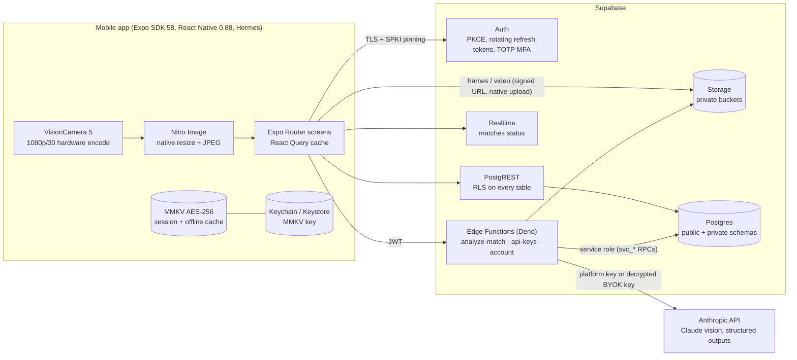
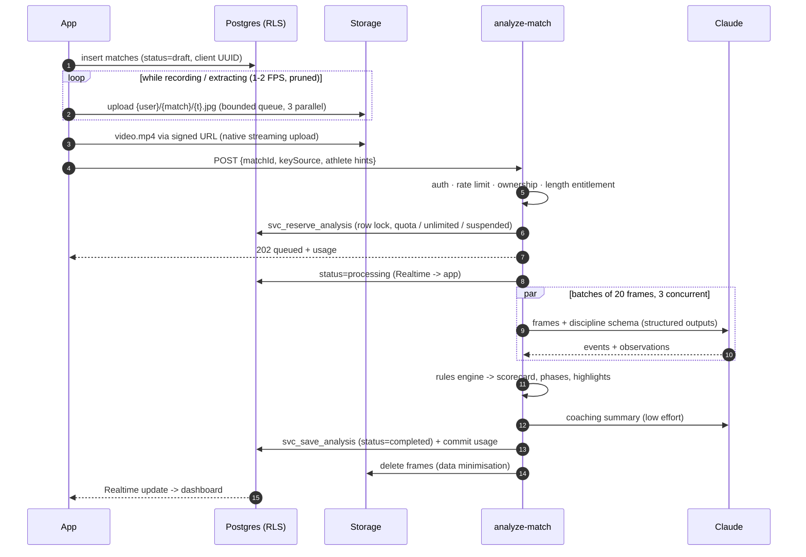
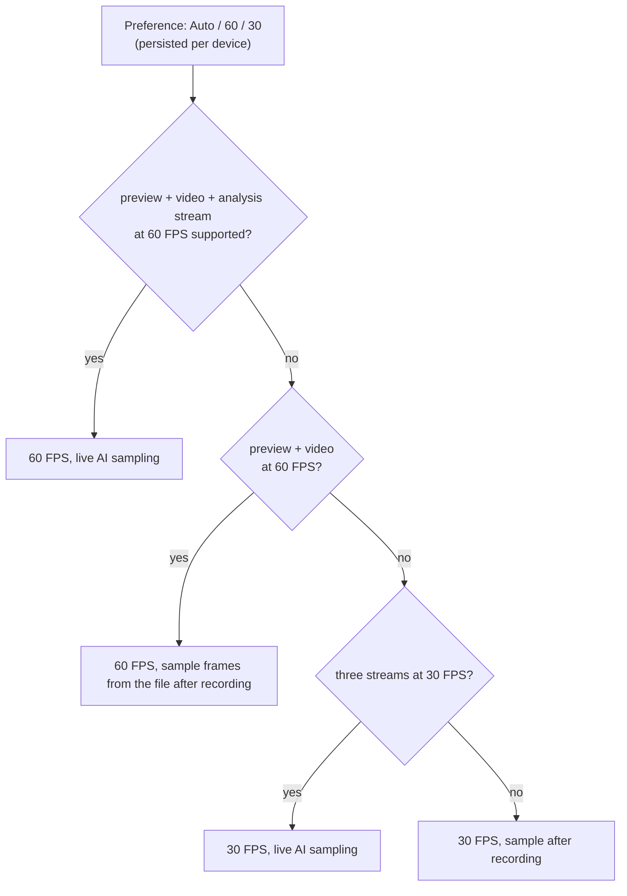
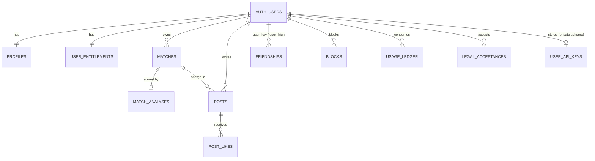

# MatIQ architecture

## System overview

| Layer | Responsibility | Key files |
|---|---|---|
| Mobile app | Capture, local encryption, UI, optimistic caching | `apps/mobile/src` |
| Rules engine | Deterministic scoring shared by app and server | `packages/rules-engine` |
| Postgres | Data, RLS privacy rules, quotas, rate limits, audit log | `supabase/migrations` |
| Edge Functions | AI orchestration, BYOK vault, data export/deletion | `supabase/functions` |
| Anthropic API | Event detection from frames, coaching notes | `supabase/functions/_shared/ai` |

## Analysis pipeline

Failure at any step marks the match `failed` with an error code and refunds
the reservation; reservations abandoned by a crashed worker are refunded
automatically after 30 minutes.

### Why the AI only detects events

Vision models are good at recognising *what happened* and poor at applying
rulebooks consistently. MatIQ therefore splits the job:

1. Claude receives timestamped frames and a schema generated from the rules
   engine's vocabulary (`_shared/ai/schemas.ts`), so it can only emit known
   event types.
2. The rules engine (`packages/rules-engine`) validates every event again,
   drops low-confidence ones, and computes points, advantages, round scores,
   phases and highlights deterministically.
3. Raw events are stored next to the scorecard, so matches can be re-scored
   when rules change without paying for another AI call.

## Capture and performance (30-60 FPS)

Recording targets **60 FPS** and never drops below **30 FPS**. The frame rate
and output combination are chosen per device before the session starts:

`useCapturePlan` asks VisionCamera to negotiate each candidate
(`resolveConstraints`) and verifies it (`isSessionConfigSupported`), so a
recording never starts in a configuration the hardware cannot sustain.

| Concern | Approach |
|---|---|
| Preview / recording at 60 FPS | Fully native (VisionCamera 5, Nitro/JSI): buffers go straight to the preview layer and the hardware encoder. JS never touches full-rate frames. |
| Session constraints | Priority order: `fps` > recording resolution > stabilization off > 8-bit SDR > binned sensor readout. Each later constraint removes a common reason devices fall back to 30 FPS (stabilization crop/latency, HDR bandwidth, full-sensor readout). Low-light boost is disabled because it lowers the frame rate to lengthen exposure. |
| AI sampling | A worklet on the frame output's own thread (`frame-thread-sampler.ts`). Per frame it only counts (live FPS measurement) and disposes the buffer; about once per second it converts, downscales to 640 px, prunes static frames (16-px luminance signature) and encodes a JPEG asynchronously. Only a file path reaches JS. |
| Buffer pool | Every frame is disposed exactly once in a `finally`; an undisposed frame would stall the whole camera pipeline, preview included. |
| Analysis stream cost | Preview-sized buffers (`enablePreviewSizedOutputBuffers`), `dropFramesWhileBusy`, deferred start so preview comes up first. |
| React re-renders | `<Camera>` props (outputs, constraints, callbacks) are memoized on the plan. Recording clock and stats flow through an external store that only the HUD subscribes to, so the camera subtree does not re-render while recording. |
| Backpressure | The JS side doubles the sampling interval when the upload queue is more than 75% full; the queue itself is a 120-frame ring buffer. |
| Thermal pressure | An iOS system-pressure interruption stops and saves the take, and the HUD suggests 30 FPS. |
| Bit rate | 14 Mbps for Auto/60, 9 Mbps for 30 FPS (1080p; platform default codec, which is HEVC on most iPhones). |
| Large videos | Streamed from disk by the OS uploader (`expo-file-system` `File.upload`, background session on iOS) to a short-lived signed URL. |
| Gallery uploads / record-only plans | `expo-video-thumbnails` decodes one frame at a time from the file, then the same pruning and JPEG path; sampling and the video upload run in parallel. |

The HUD shows the negotiated FPS before the first frame arrives and the
measured, delivered FPS once the analysis stream is running.

## Data model

`private` schema (not exposed through the API): `user_api_keys`,
`rate_limits`, `admin_audit_log`, `app_config`, and every helper used by RLS.

## Privacy model

Effective visibility of a **post** (and of the match, analysis and video it
shares), enforced by `private.can_view_author_content`:

| Viewer | Author account | Post | Visible? |
|---|---|---|---|
| Author | any | any | yes |
| Blocked (either direction) | any | any | **no** |
| Accepted friend | any | any | yes |
| Other signed-in user | Public | not friends-only | yes |
| Other signed-in user | Public | friends-only | no |
| Other signed-in user | Private (default) | any | no |
| Anonymous | any | any | no (anon has no table access) |

Matches, analyses and videos that are **not** shared in a post are visible
only to their owner. Profile cards (username, display name, avatar, bio) are
visible to signed-in users who are not blocked, so friend requests work for
private accounts.

The feed (`get_feed`) is `SECURITY INVOKER`: it runs under the caller's RLS,
so it cannot return anything the caller could not read directly.

## Usage limits

- `user_entitlements` holds `role`, `is_unlimited`, `monthly_analysis_limit`,
  `max_video_seconds`, `is_suspended`. Clients can read only their own row and
  cannot write it (no write grants, no write policies).
- `svc_reserve_analysis` locks the entitlements row (`FOR UPDATE`), sums the
  month's reserved + committed units and inserts a reservation, so concurrent
  requests cannot both pass. `is_unlimited = true` bypasses the cap; BYOK
  analyses are recorded with 0 units.
- Owner Panel RPCs (`admin_*`) re-check `role = 'owner'` on every call,
  optionally require an MFA (aal2) session, are rate limited, and append to
  `private.admin_audit_log` (update/delete blocked by trigger).

## Known limits and next steps

- **Long videos:** analysis runs as a background task inside the Edge
  Function, bounded by the platform's wall-clock limit. The defaults
  (240 frames, 20 per request, 3 concurrent) fit typical rounds. For longer
  sessions, move the pipeline to a queue (Supabase Queues / pgmq) with a
  worker that processes one batch per invocation.
- **Resumable uploads:** signed-URL uploads are single requests. For very
  large files on poor networks, switch to Supabase's TUS endpoint with a
  native TUS client.
- **Pinning coverage:** pinning applies to `fetch` traffic. Native
  file uploads use the OS networking stack; they only carry short-lived,
  path-scoped signed URLs.
- **Typed database client:** generate types with
  `supabase gen types typescript --local > apps/mobile/src/types/database.ts`
  and pass them to `createClient<Database>()`.
- **Device integrity:** add App Attest / Play Integrity verification in an
  Edge Function before trusting high-cost requests.
- **Model evaluation:** build a labelled set of rounds to measure event
  precision/recall per discipline before tuning prompts or sampling rates.
